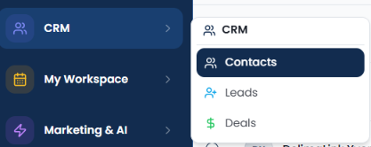

# CRM

The **Seampify CRM (Customer Relationship Management)** module allows businesses to manage customer information, track sales opportunities, and monitor their sales pipeline from a centralized platform.

The CRM module consists of three main sections:

| **Section** | **Description**                                                                              |
| ----------- | -------------------------------------------------------------------------------------------- |
| Contacts    | Manage customer information, contact details, and customer segmentation.                     |
| Leads       | Track potential sales opportunities and customer interest.                                   |
| Deals       | Manage qualified sales opportunities and track potential revenue through the sales pipeline. |

## Accessing CRM

1. Log in to your Seampify account.
2. Click **CRM** on the left-hand navigation menu.
3. Select **Contacts**, **Leads**, or **Deals** from the submenu.

<figure><figcaption></figcaption></figure>

Before you can create any tasks or deals, you'll need to set up and define your stages first under **CRM Settings**.


[crm.md](../settings/workspace-settings/crm.md)


