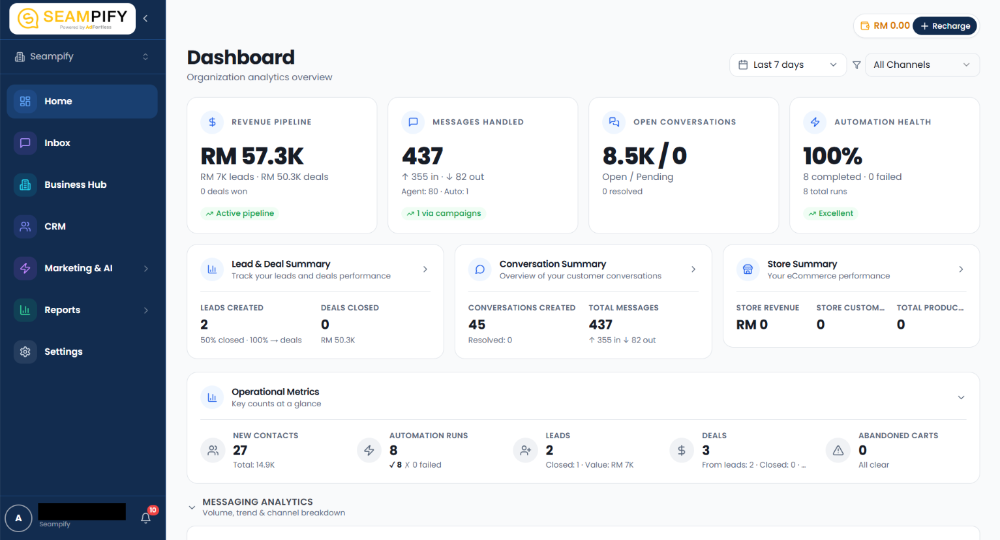

# Home

Once you have logged in to Seampify, you will be directed to the Dashboard page. Here, you may have a glance at conversations; access different modules, and much more.

The **Seampify Dashboard** provides a centralized overview of your organization's performance, allowing you to monitor customer conversations, messaging activities, sales pipelines, automation performance, and eCommerce operations from a single page.


Depending on your user's roles and permission set, you may see differently from others.


<figure><figcaption></figcaption></figure>

You can customize the information displayed on your Dashboard using the filters located at the top-right corner.

| **Filter**   | **Description**                                               |
| ------------ | ------------------------------------------------------------- |
| Date Range   | View analytics based on the selected time period.             |
| Channel      | Filter analytics based on the selected communication channel. |
| All Channels | View combined analytics across all channels.                  |

### Key Performance Indicators (KPIs)

The top section of the Dashboard displays four key performance indicators that provide a quick overview of your business performance.

#### Revenue Pipeline

Displays the overall value of your sales pipeline.

| **Metric**       | **Description**                                    |
| ---------------- | -------------------------------------------------- |
| Revenue Pipeline | Combined value of leads and deals in the pipeline. |
| Leads Value      | Total monetary value associated with leads.        |
| Deals Value      | Total monetary value associated with deals.        |
| Deals Won        | Number of successfully won deals.                  |

#### Messages Handled

Displays the total messaging activities within your organization.

| **Metric**        | **Description**                                 |
| ----------------- | ----------------------------------------------- |
| Total Messages    | Total number of incoming and outgoing messages. |
| Incoming Messages | Messages received from customers.               |
| Outgoing Messages | Messages sent to customers.                     |
| Agent             | Messages handled by human agents.               |
| Auto              | Messages handled through automation.            |
| Campaigns         | Messages attributed to campaigns.               |

#### Open Conversations

Provides an overview of your customer conversation statuses.

| **Metric** | **Description**                                  |
| ---------- | ------------------------------------------------ |
| Open       | Number of conversations that remain open.        |
| Pending    | Number of conversations marked as pending.       |
| Resolved   | Number of conversations that have been resolved. |

#### Automation Health

Displays the overall performance and success rate of your automation processes.

| **Metric**   | **Description**                                       |
| ------------ | ----------------------------------------------------- |
| Success Rate | Percentage of successfully completed automation runs. |
| Completed    | Number of successfully completed automation runs.     |
| Failed       | Number of failed automation runs.                     |
| Total Runs   | Total number of automation executions.                |

### Performance Summary

The Performance Summary section provides a breakdown of three key business areas.

#### Lead & Deal Summary

Track your sales and lead management performance, including:

* Number of leads created.
* Number of deals closed.
* Lead-to-deal conversion rate.
* Deal closing rate.
* Deal value.

#### Conversation Summary

Monitor your organization's customer engagement and messaging activities, including:

* Conversations created.
* Conversations resolved.
* Total messages.
* Incoming messages.
* Outgoing messages.

#### Store Summary

Monitor your eCommerce performance, including:

* Total store revenue.
* Number of store customers.
* Total number of products.

### Operational Metrics

The Operational Metrics section provides a quick overview of your organization's key operational activities.

| **Metric**      | **Description**                                                                           |
| --------------- | ----------------------------------------------------------------------------------------- |
| New Contacts    | Number of newly added contacts and total existing contacts.                               |
| Automation Runs | Number of automation executions, including successful and failed runs.                    |
| Leads           | Number of leads, closed leads, and associated monetary value.                             |
| Deals           | Number of deals, deals generated from leads, closed deals, and associated monetary value. |
| Abandoned Carts | Number of abandoned shopping carts.                                                       |

### Detailed Analytics

The Dashboard also provides expandable analytics sections that allow you to explore specific areas of your organization's performance in greater detail.

<figure><figcaption></figcaption></figure>

Click on the arrow beside each section to expand and view its detailed analytics.

## Accessing Modules

Head over to the left sidebar to access different modules of Seampify.

<figure><figcaption></figcaption></figure>

You can also close the sidebar by clicking the button in the top right corner of the sidebar.
