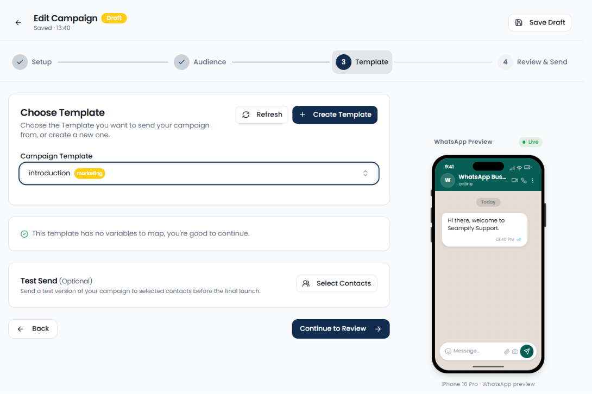

# Campaign

The **Campaigns** section allows businesses to create, manage, and monitor messaging campaigns from a centralized dashboard.

<figure><figcaption></figcaption></figure>

Key features include:

* Create and manage messaging campaigns.
* Send campaigns immediately or schedule them for a later time.
* Manage recurring campaigns.
* Monitor campaign statuses and identify campaigns requiring attention.
* Track messaging performance, including sent, delivered, and read messages.

**Example use cases:** Promotional campaigns, event invitations, announcements, subscription renewals, and customer reminders.

## Creating a Campaign

The **Campaigns** section allows users to create, configure, schedule, and send messaging campaigns to selected contacts.

To create a campaign, navigate to **Marketing & AI → Campaigns → + Create Campaign**.

The campaign creation process consists of four steps:

1. Setup
2. Audience
3. Template
4. Review & Send

### _Step 1 : Setup_

The Setup section allows users to configure the basic campaign information, select a sender, and determine how the campaign will be delivered.

<figure><figcaption></figcaption></figure>

#### Campaign Name

Enter a name for your campaign. The campaign name helps users identify and manage campaigns within the Campaigns dashboard.

* Campaign Name is a required field.
* A maximum of 120 characters is allowed.
* Campaign drafts are automatically saved as you work.

The **Advanced Configuration** section can be expanded to access additional campaign settings.

#### Choose Sender

Select the sender account that will be used to send the campaign.

Users can search for available senders by name, phone number, or verified name, and filter them by channel.

Each sender card displays the following information:

| **Information**   | **Description**                                   |
| ----------------- | ------------------------------------------------- |
| Sender Name       | Name of the connected sender account.             |
| Channel           | Communication channel associated with the sender. |
| Phone Number      | Phone number associated with the sender.          |
| Verified Name     | Business name associated with the sender.         |
| Quality Rating    | Current quality rating of the sender.             |
| Connection Status | Indicates whether the sender is connected.        |

#### Campaign Type

Select how you would like your campaign to be delivered.

<strong>Send Immediately</strong>

Start right after approval.

<strong>Schedule Once</strong>

Set a future date and time.

<strong>Recurring Campaign</strong>

Repeats on a configured schedule.

#### Campaign Summary

The Campaign Summary panel displays the current campaign configuration, including:

| **Field**  | **Description**                                     |
| ---------- | --------------------------------------------------- |
| Campaign   | Name of the campaign.                               |
| Sender     | Selected sender account.                            |
| Channel    | Selected communication channel.                     |
| Throughput | Message processing capacity of the sender.          |
| Audience   | Selected campaign recipients, configured in Step 2. |
| Schedule   | Selected campaign delivery method.                  |

The checklist indicates whether the campaign name, sender, and schedule have been configured.

<figure><figcaption></figcaption></figure>

Once completed, click **Continue to Audience**.

### _Step 2 : Audience_

The Audience section allows users to select the contacts who will receive the campaign.

<figure><figcaption></figcaption></figure>

#### Audience Selection Methods

There are three available methods for selecting campaign recipients.

| **Method**        | **Description**                                        |
| ----------------- | ------------------------------------------------------ |
| Existing Contacts | Select recipients from your existing contact database. |
| Contact Lists     | Select recipients from existing contact lists.         |
| Upload Contacts   | Upload contacts to be used as campaign recipients.     |

#### Audience Filters

Audience filters allow users to narrow down their target audience based on specific criteria.

Click **+ Add filter** to configure audience filtering conditions.

By default, if no filters are applied, the audience includes every eligible contact associated with the selected channel.

The number of **matching contacts** indicates how many contacts meet the current filtering conditions.


**Important:** Review the selected audience and ensure the recipients have provided the necessary consent to receive your campaign before proceeding.


Your audience selection is saved automatically.

Continue to the **Template** section once the audience has been selected.

### _Step 3 : Template_

The Template section allows users to select the message template that will be sent to the campaign audience.

<figure><figcaption></figcaption></figure>

#### Choose Template

Select an available message template from the **Campaign Template** dropdown.

| **Option**        | **Description**                                          |
| ----------------- | -------------------------------------------------------- |
| Campaign Template | Select the message template to be used for the campaign. |
| Refresh           | Refresh the list of available message templates.         |
| Create Template   | Create a new message template.                           |

The template category, such as **Marketing**, is displayed beside the selected template name.

#### Template Variable Mapping

If the selected template contains variables, configure the required variable mappings before proceeding.

Variables allow message content to be personalized for individual recipients.

If the selected template does not contain any variables, the system will display the following notification:

> This template has no variables to map, you're good to continue.

#### WhatsApp Preview

The WhatsApp Preview panel displays a live preview of the selected message template, allowing users to review how the message may appear to recipients.

Actual personalized values are retrieved for each contact at the time of sending.

#### Test Send (Optional)

The **Test Send** feature allows users to send a test version of the campaign to selected contacts before the final launch.

Click **Select Contacts** to choose the recipients of the test message.

It is recommended to perform a test send to verify the message content and personalization before launching the campaign.

Once completed, click **Continue to Review**.

### Step 4 : Review & Send

| Field             | Description                                                      |
| ----------------- | ---------------------------------------------------------------- |
| **Campaign Name** | **Name of the campaign.**                                        |
| Template          | Selected message template and its language.                      |
| Audience          | Number of selected recipients and the audience selection method. |
| Estimated Cost    | Estimated wallet cost of sending the campaign, where applicable. |

For accounts that are not billed through the wallet, the system will display a notification indicating that the campaign has no wallet cost.

**Note:** No wallet cost does not necessarily mean that no messaging charges apply.


All template messages are chargeable by Meta. Click [here](../../useful-guides/conversation-through-whatsapp-cloud-api.md#id-2.-whatsapp-message-categories) to see the pricing.


#### Campaign Sending Method

Under **How would you like to send your campaign?**, review or configure the campaign delivery method.

For scheduled campaigns, select the required **Date & Time**.

The system displays the organization's timezone below the selected date and time.

#### Schedule Summary

The Schedule Summary displays the final campaign execution details.

<figure><figcaption></figcaption></figure>

Scheduled campaigns will automatically start at the configured time without requiring manual action.

#### Submit Campaign

Before submitting the campaign, review the following:

* Campaign name and sender.
* Selected audience and recipient count.
* Message template and variable mappings.
* WhatsApp message preview.
* Estimated cost, where applicable.
* Sending schedule and timezone.

Once all information has been verified, click the campaign submission button. For scheduled campaigns, click **Schedule Campaign**.

### Saving a Campaign as Draft

Users can click **Save Draft** at the top-right corner during the campaign creation process to save their progress without launching the campaign.

<figure><figcaption></figcaption></figure>

Campaign drafts are also automatically saved as users complete the configuration.

Saved drafts can be accessed from the **Campaigns** dashboard, where users can continue their configuration using **Resume draft** or **Finish setup**, where applicable.
