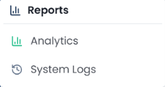

# Reports

The **Reports** module in Seampify provides insights into your organization's performance and a detailed history of system activities.

The module consists of two main sections:

| **Section** | **Description**                                                                                                      |
| ----------- | -------------------------------------------------------------------------------------------------------------------- |
| Analytics   | Monitor messaging activities, conversations, agent performance, time tracking, CRM sales, and eCommerce performance. |
| System Logs | View activity records across messaging channels, agents, integrations, and system components.                        |

## Accessing Reports

1. Log in to your Seampify account.
2. Click **Reports** on the left-hand navigation menu.
3. Select **Analytics** or **System Logs**.

<figure><figcaption></figcaption></figure>

