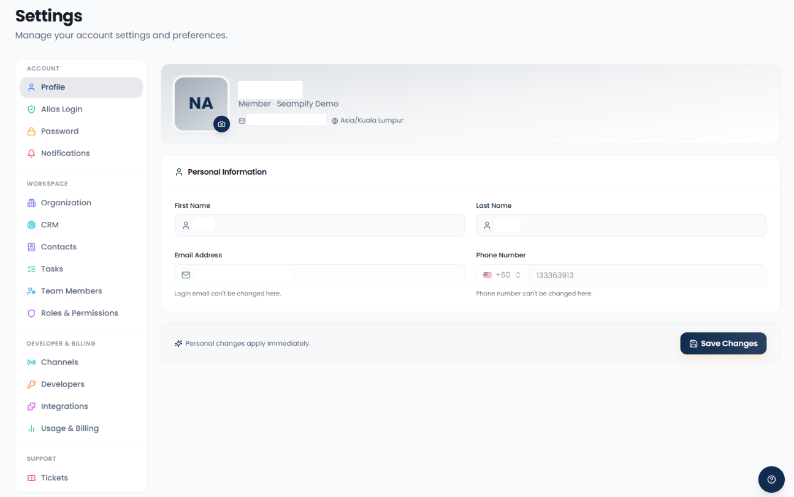

# Settings

The **Settings** module in Seampify allows users to manage their account information, workspace configurations, communication channels, integrations, and billing preferences.

The module is divided into four main categories:

| **Category**        | **Description**                                                                            |
| ------------------- | ------------------------------------------------------------------------------------------ |
| Account             | Manage personal account information, login settings, passwords, and notifications.         |
| Workspace           | Configure organization settings, CRM, contacts, tasks, team members, and user permissions. |
| Developer & Billing | Manage communication channels, developer settings, integrations, and billing information.  |
| Support             | Access the ticketing system for support-related enquiries.                                 |

## Accessing Settings

1. Log in to your Seampify account.
2. Click **Settings** on the left-hand navigation menu.
3. Select the relevant settings category from the menu.

<figure><figcaption></figcaption></figure>
