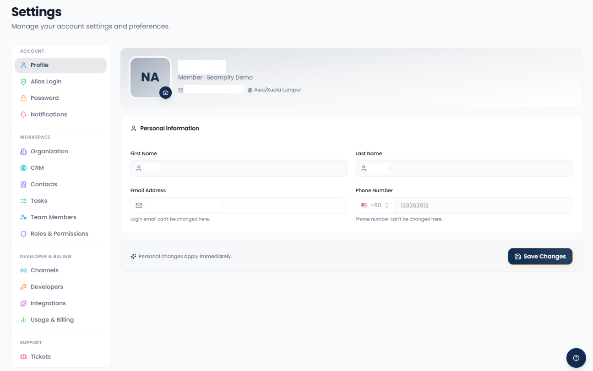

# Account Settings

The **Account** category allows users to manage their personal account information and preferences.

<figure><figcaption></figcaption></figure>

| **Section**   | **Description**                                                                             |
| ------------- | ------------------------------------------------------------------------------------------- |
| Profile       | View and update personal information, including first name, last name, and profile picture. |
| Alias Login   | Access alias login settings.                                                                |
| Password      | Manage account password settings.                                                           |
| Notifications | Manage notification preferences.                                                            |

### Profile

The **Profile** section displays the user's account information, including their name, organization membership, email address, and timezone.

**Personal Information**

| **Field**       | **Description**                                                                             |
| --------------- | ------------------------------------------------------------------------------------------- |
| Profile Picture | Upload or change your profile picture using the camera icon.                                |
| First Name      | Update your first name.                                                                     |
| Last Name       | Update your last name.                                                                      |
| Email Address   | Displays your registered login email address. This cannot be changed from the Profile page. |
| Phone Number    | Displays your registered phone number. This cannot be changed from the Profile page.        |
| Timezone        | Displays the timezone associated with your account.                                         |

To update your personal information, make the necessary changes and click **Save Changes**.

Personal information changes take effect immediately.
