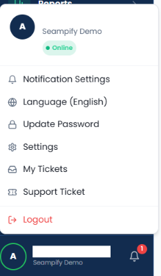

# Tickets

The **Support Tickets** section allows you to report technical issues, submit support requests, and track the status of tickets you have raised with the Seampify Support Team.

You can provide detailed descriptions, attach screenshots, and indicate the urgency of your issue to help our support team investigate and assist you.


**Note:** Available settings and configuration options may vary depending on your account permissions and organization's configuration.


## Accessing Support Tickets

### From Settings

1. Log in to your Seampify account.
2. Navigate to **Settings → Tickets** under the Support section.
3. The Tickets page will display your submitted tickets and their statuses.

<figure><figcaption></figcaption></figure>

### From Profile Settings

1. Log in to your Seampify account.
2. Navigate to profile at below and click your email.
3. Choose **Support Ticket** to raise a ticket.
4. Or choose **My Tickets** to see your tickets that has been raised. You can still raise another ticket from **My Tickets** setion.
5. The Tickets page will display your submitted tickets and their statuses.

<figure><figcaption></figcaption></figure>

## Creating a Support Ticket

To report an issue:

1. Navigate to **Settings → Tickets**.
2. Click **+ Raise** or **+ Raise a Ticket**.

<figure><figcaption></figcaption></figure>

3. Complete the **Create Support Ticket** form.

<figure><figcaption></figcaption></figure>

4. Attach relevant screenshots or supporting files, if needed.
5. Click **Create Ticket** to submit your request.

### Ticket Information & **Details**

When submitting a ticket, include sufficient information to help our support team understand and investigate your issue.\
\
To make investigation smoother, we recommend you to attach any screenshots, videos or supporting documents. You can attach multiple files, up to 25 MB each.

## Tracking Your Support Tickets

Once your ticket has been submitted, you can return to **Settings → Tickets** to view the tickets you have raised and their current statuses.

<figure><figcaption></figcaption></figure>

This allows you to monitor your reported issues and keep track of your support requests.

## Alternative Support – WhatsApp Group

Besides submitting a support ticket through Seampify, **you can also reach out to our Support Team directly through your existing WhatsApp support group**.

You can message us in the group to report an issue, ask a question, or request assistance.

For technical issues requiring further investigation, our team may ask you to raise a support ticket so the issue can be properly documented and tracked.
