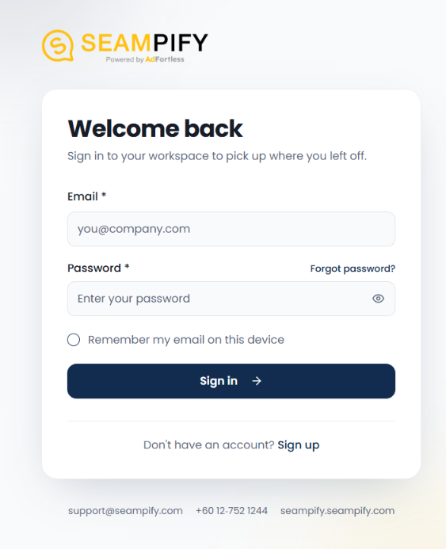

# Sign up your Seampify account

## Sign Up Your Account

To create an account with Seampify , visit the Seampify registration page.


If you already have an Account, click the link [Login Seampify Account](login-to-your-seampify-account.md)


### _**Step 1: Fill out the Registration Form**_

You will be greeted with the registration form as shown below to begin the sign-up process.

<figure><figcaption></figcaption></figure>

Fill in the following information accordingly:



Enter Your Email Address

<mark style="color:red;">e.g: abc@gmail.com</mark>


This email address used here will be the Master User of your account.




Enter the OTP code sent to the email and Verify

<figure><figcaption></figcaption></figure>



Set the password and wait for Administrator Approval

<figure><figcaption></figcaption></figure> <figure><figcaption></figcaption></figure>




Login with your details

<figure><figcaption></figcaption></figure>




[connecting-to-whatsapp-cloud-api](../connecting-to-whatsapp-cloud-api/)

